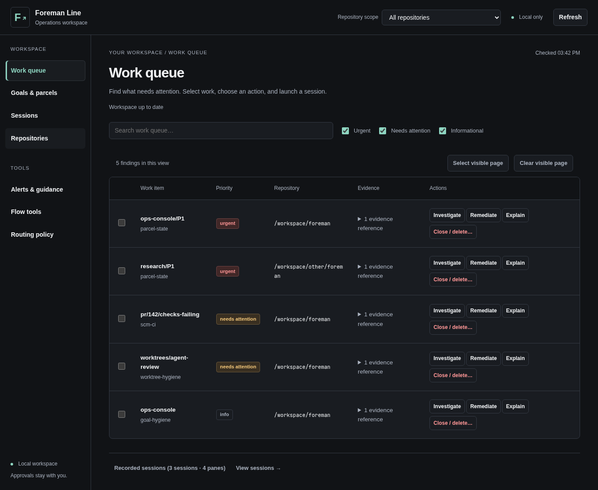
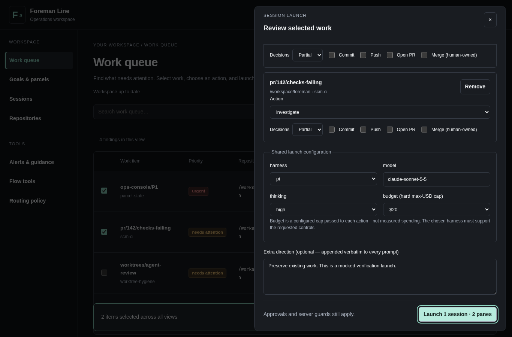
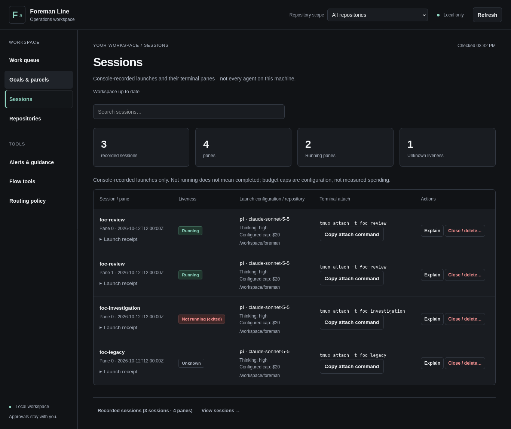

# UX redesign verification — 2026-10-12

Implementation verified at `b57f7ff6` on `feat/ops-console-ux-redesign`.
Owner approved the specs and delegated non-destructive implementation decisions.
Root planning/task files and coordinator ownership were not changed. The three
specs remain active contracts pending human review/merge—not silently shipped.

## Delivered workflow

**Find work → select items → choose actions and permissions → review shared
configuration → launch one session/N panes → inspect recorded sessions.**

- Work queue is the default; four primary destinations have purpose copy.
  Alerts & guidance, Flow tools and read-only Routing policy remain reachable.
- Exact repository roots scope queue/sessions and goal choices; repository
  management still lists all roots. Search, severity/state filters, active/inactive
  goals, hash navigation and pagination work. Skip-to-content preserves the view.
- Full signal ids own selection. Parcel selection requires an authoritative
  parcel-state finding matching both qualified goal/parcel and absolute root.
- Default Investigate only when offered/registered/non-destructive/spawnable;
  otherwise the operator explicitly chooses. No registry-first fallback and no
  destructive action in ordinary bulk launch. Per-item permissions remain explicit;
  merge stays human-owned and false in outgoing payloads.
- Selection, configuration and extra direction survive filtering/navigation and
  background refresh. Disappearing items remain visible in review. Changed action
  defaults require renewed review, never silent permission widening.
- Duplicate submission is guarded. Only a confirmed complete pane-index set clears
  the submitted selection. Uncertain/partial/malformed results preserve it, refresh
  read-only data and require explicit acknowledgement before a deliberate retry.
- Sessions distinguishes sessions from panes, known/unknown liveness from completion,
  and configured caps from spending. Receipts, paths, timestamps, prompt digests,
  attach commands and guarded actions remain inspectable. Full history is paginated.
- Responsive card rows replace squeezed mobile tables; desktop rows remain readable.
  Native dialogs have keyboard containment, Escape and focus return. Tool pages
  show their selected goal/root and link back to change it.

## Package and contract checks

| Check | Result |
|---|---|
| Baseline `npm test` | 333/333 passed |
| Final `npm test` | **347/347 passed**, no skipped tests |
| `npm run typecheck` | Pass |
| `npm run lint` | Pass |
| `npm audit` | Zero vulnerabilities (including dev dependencies) |
| `git diff --check` | Pass |
| Spec-linter public validate CLI, FCA-U1/U2/U3 | Pass |

New/updated coverage is behavioral: scope/search/hash/skip navigation, stale and
malformed snapshots, request races, pending detail across refresh, inactive goals,
200+ records, identity joins, explicit action selection, permission reconciliation,
draft retention, duplicate requests, partial success, uncertainty acknowledgement,
server-matching typed confirmation, attach fallback and session reveal/highlight.
Existing backend safety/planner tests remain in place. Obsolete structural layout
assertions and implicit-first-action expectations were replaced, not skipped.

## Actual browser verification

[Raw browser report](browser-report.json) and [re-runnable smoke harness](browser-smoke.mjs).
Every API request is intercepted with fixture data. Every write is mocked. The
fixture HTTP server only reads shipped UI assets and closes on completion.

- **Chromium 152.0.7977.82** and **Firefox 157.0** executed the workflow.
- Four primary destinations at **320, 768, 1024, 1366, 1920 CSS pixels**: no
  horizontal page overflow. Mobile text-width assertion catches one-letter columns.
- Tab/Shift+Tab containment, Escape/focus return, Shift-range selection, distinct
  same-basename scope, checked-row/draft retention after refresh, one mocked POST
  with two explicit actions, session reveal, wrong destructive intent sending no
  request, empty results, stale data, initialization failure/loading and recovery.
- **Zero axe WCAG 2 A/AA and 2.1 AA violations** in the audited states:
  seven destinations and launch review at desktop, four primary destinations at 320.
  This is 12 audits per browser, not a claim of exhaustive accessibility certification.
- **56 screenshots** captured locally (28/browser). Four representative screenshots
  are committed below. No uncaught page exception or unexpected console error;
  Chromium logs the two deliberately injected HTTP 503 failures, as expected.
- 200%-equivalent **683×450 CSS viewport** (for a 1366×900 window) has no overflow,
  and the launch button remains reachable by scrolling. This is effective-viewport
  emulation, **not an actual browser UI zoom gesture** or screen-reader testing.

### Screenshots (fictional fixture data, not operator state)







[Mobile work queue, 320px](screenshots/work-queue-mobile.png).

### Reproduce the smoke check

From `plugins/foreman-line/ops-console/`, install **test-only** tools outside the
repository. No product manifest/lockfile, runtime dependency or build step changes:

```sh
npm install --prefix /tmp/foreman-ux-browser --ignore-scripts --no-audit --no-fund playwright @axe-core/playwright
/tmp/foreman-ux-browser/node_modules/.bin/playwright install firefox
node ../docs/goals/foreman-ops-console/ux-redesign/tasks/browser-smoke.mjs
```

Defaults: `/usr/bin/chromium`, tool root `/tmp/foreman-ux-browser`, output
`/tmp/foreman-ux-browser/evidence`. Override with `FOC_CHROMIUM`,
`FOC_BROWSER_TOOL_ROOT`, `FOC_BROWSER_EVIDENCE_DIR`; optional first argument is the
absolute package directory. Browsers use isolated Playwright contexts, not the
operator's profile. Browser tooling is intentionally not a project dependency.

## Review and corrections

An independent Claude Sonnet 5.5 read-only code reviewer requested changes, then
re-reviewed the fixes and reported **no remaining Critical/Required findings**.
It did not run tests; the second pass inspected the core UI modules and excerpts
of alias code/test coverage, not a fresh exhaustive repository audit. Local raw
review streams: `/tmp/foreman-ux-browser/{review,rereview}.jsonl`.

| Finding | Resolution / evidence |
|---|---|
| Partial success could clear every selected target | Validate complete, unique, in-range pane indices before clearing anything; regression fails without fix. Backend normally refuses partial launches, but malformed success is now conservative too. |
| Shared goal/detail generation could strand loading evidence | Separate counters; refresh a currently open detail. Pending-detail regression reproduced and now passes. |
| Identical goal keys across same-basename roots | Existing backend defect, not fixable by UI labels alone. Globally reserve tree aliases with the existing numeric suffix; API/root regression proves uniqueness and exact resolution. Non-colliding and primary keys unchanged. Spec amendment records the delegated scope decision. |
| Uncertain requests could be resubmitted immediately | Read-only refresh and explicit “I inspected Sessions” acknowledgement. No automatic retry. Do not call all HTTP 400 results side-effect-free: existing backend can return launch-failure after worktree creation. |
| Registry merge defaults could escape disabled controls | Force false in selection and payload as defence in depth; backend human-merge guard remains authoritative. |
| Clicking the same row action erased its reviewed permissions | Reuse same-verb drafts. Changing verbs explicitly resets to that verb's conservative defaults; the tooltip and drawer identify the all-selected scope. |
| Mobile columns passed overflow tests but were unreadable | Real screenshot inspection + a failing browser text-width assertion; responsive cards and 24px selection controls; rerun both browsers. |
| Session metric numbers lacked layout / duplicated labels | Metric cards with one count and a separate label; screenshot inspection. |
| Skip link changed the hash/view | Prevent fragment navigation, focus/scroll main without changing active view; regression reproduced and fixed. |
| Null/malformed finding entries could crash refresh | Validate snapshot entry shapes at the browser read boundary; preserve last-known data and stale feedback. |

## Rollout and rollback (not executed)

1. Human reviews/approves the PR; merge is not automated under the owner's identity.
2. Restart the local console with the existing explicit environment and state
   directory, then reload. Check health, root metadata, queue/scope/selection and
   session receipt inspection before intentionally launching anything.
3. Watch the browser console, visible stale/error feedback and existing backend
   invocation/spawn audit records. Wrong-root behavior, new uncaught errors or loss
   of uncertainty/confirmation safeguards are stop-use/rollback triggers.
4. Roll back by deploying the previous approved revision (or a normal reviewed
   revert), retaining the same console state directory and restarting the console.
   No data migration/schema change requires reversal. Preserve receipts, worktrees
   and any running tmux sessions; do not treat rollback as session cleanup.
   Old ambiguous aliases should not be relied on after reverting the collision fix.

This is a localhost operator tool, not a public-service deployment. No production
canary/SLO dashboard, feature-flag service or external telemetry dependency was
introduced. The isolated mocked browser server is the staging/preview surface;
actual operator adoption and post-launch checks remain human-owned.

## Scope and remaining human checks

- No real tmux launch, worktree creation, close/delete or human approval performed.
  Real launcher behavior still has the existing backend/stub tests; mocked browser
  success is not represented as a real process-launch test.
- No new goals, coordinator handoff, write API, projection rule, framework, CDN,
  font, product dependency or build pipeline was introduced.
- Goal root metadata is additive. Existing alias collisions are corrected narrowly;
  ambiguous old aliases could not previously resolve the second checkout correctly.
- Core UI integration was committed at one verified savepoint because controller,
  shell and replacement DOM tests share interfaces; API/alias changes and subsequent
  review fixes have separate commits. Interface declarations changed with behavior,
  rather than producing deliberately broken intermediate commits.
- Human merge approval remains outstanding. Suggested final human checks: actual
  browser zoom gesture and assistive-technology use; subjective visual preference;
  any real launch only in a disposable checkout with deliberate operator intent.
- To adopt after review/merge, restart the console with its **existing explicit
  FOC_REPO_ROOT / FOC_EXTRA_ROOTS / FOC_STATE_DIR / PORT configuration**, then reload.
  A running Node process needs a restart for new root metadata/alias code. No
  operator server was stopped or restarted as part of mocked verification.
